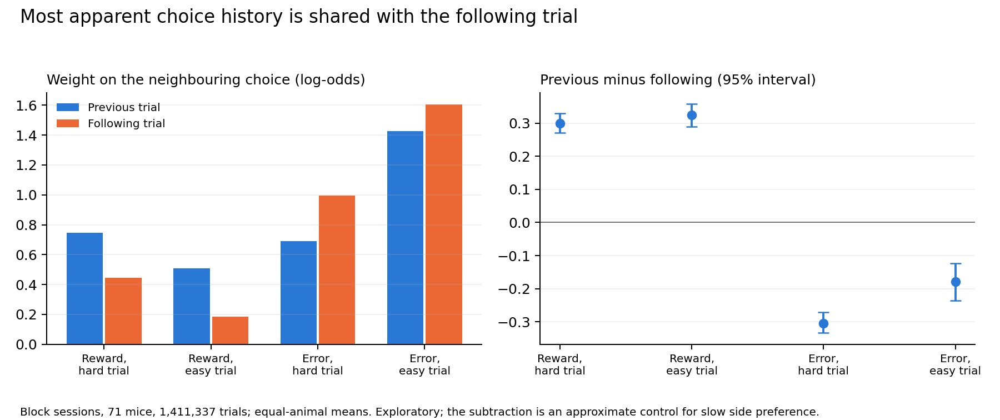

# AnimalTaskSim

**Test explanations of animal decisions against trial-level behavioral data.**

AnimalTaskSim provides task environments, comparison agents, schema-validated
trial logs, and a shared evaluation pipeline. Explanations are judged by
held-out prediction of animal choices and by behavioral fingerprints, not by
reward alone.

## What has been established

**1. A source-verified mouse reference.** The adopted IBL reference (120
sessions, 86,648 trials) was reconciled against the public ALF arrays. It covers
**83 mice across 9 labs**. Reconciliation found **255 misclassified omissions**
in 49 sessions, corrected in a separate candidate file. With that correction the
raw weak-minus-strong failure retry gap is **−0.0853**: the opposite sign to the
signature the earlier adaptive controller was built to produce.
[Source reconciliation](docs/SOURCE_RECONCILIATION.md).

**2. A small evidence-dependent history effect that replicated.** Models and
rules were frozen before a reserved cohort was downloaded. On the 45 of 60 mice
that met the fixed QC gates, adding evidence-dependent outcome history improved
prediction by **0.00160 nats/trial** (95% subject-bootstrap interval
**[0.00082, 0.00244]**; 32/45 mice improved). No test-data fitting, threshold
changes, or replacement subjects were used.
[Result and limitations](docs/REPLICATION_RESULT.md) ·
[Frozen protocol](docs/REPLICATION_PROTOCOL.md).


This is a small predictive effect under specified controls. It is not a neural
mechanism and not a novelty claim: difficulty-dependent history has close
precedents ([literature comparison](docs/NOVELTY_REVIEW.md)). The freeze was
internal, not an external preregistration, and 21 of the 45 mice come from one lab.

## What has not been established

**The effect is not yet separated from slow drift or state switching.** On 83
development mice, trial history still improves prediction after adding an
explicit drift model (**+0.0146 nats/trial**) or a three-state GLM-HMM
(**+0.0143**). But the recovery study did not pass its gate: across 360
simulations, strong history effects were recovered in 40/40 runs and weak ones
in 0/40, and the drift grid missed its numerical tolerance. Earlier small
simulations also showed drift alone can produce apparent history gains.
[Generative comparison](docs/GENERATIVE_COMPARISON.md) ·
[Protocol and mathematics](docs/GENERATIVE_COMPARISON_PROTOCOL.md) ·
[Bias controls](docs/BIAS_HISTORY.md) ·
[Competing history models](docs/COMPETING_HISTORY.md).

**The hybrid architecture is not validated.** The original research question
was whether separating longer-term memory from fast outcome-driven adaptation
improves prediction of animal choices and response times.

- After a September repair of feedback access, DDM conventions and training
  continuity, the full model **did not pass** its first prediction gate: it lost
  to a one-step history predictor (choice NLL 0.52579 vs 0.46450).
  [Repair](docs/ARCHITECTURE_REPAIR.md) · [Validation](docs/ARCHITECTURE_VALIDATION.md).
- With longer choice-only training it does beat simple history (0.44654 vs
  0.46450), on reused development animals and with worse timing error.
  [Fitting diagnosis](docs/FITTING_DIAGNOSIS.md).
- The adaptive controller adds nothing resolvable over the reduced recurrent
  model (0.44585 vs 0.44654, interval spanning both directions).
  [Matched comparison](docs/MATCHED_CHOICE_CONTROL.md).

A software lesion establishes a contribution within a model; it does not
establish a necessary mechanism in an animal.

**The evidence effect is not symmetric across outcomes.** Split by previous
outcome on the development mice, the reward half of the effect loses about 80%
of its gain under side-bias and longer-history controls; the error half loses
about 30%. Both remain small and narrowly positive. A prediction that the reward
half would vanish entirely **failed**. [Outcome split](docs/OUTCOME_SPLIT.md).

**Sixteen reference sessions are not standard protocol.** The adopted reference
includes 14 optogenetic and 2 altered-reward sessions. Removing them changes no
development result in sign or beyond its interval, including the generative
refit. [Sensitivity check](docs/VARIANT_SENSITIVITY.md).

## Where the project stands

**The direction changed on November 23, 2026: slow state before trial history.**
A deeper reference now holds every standard session of the development mice:
**3,946 sessions, 2.54 million trials, 72 mice**, 21 to 103 sessions per mouse.
A first exploratory look suggests the largest structure in the behaviour is
slow. The following trial predicts the current choice almost as well as the
previous one does, which marks most apparent "history" as lasting side
preference. Individual differences are stable across sessions (split-half
r = 0.88 for reward-driven repetition).
[First look](docs/DEEP_EXPLORATION.md) ·
[Acquisition protocol](docs/DEEP_REFERENCE_PROTOCOL.md).



The project now asks how much of choice behaviour is explained by slowly
changing latent state within each animal, and what remains for trial history
afterwards. Fixed, drifting and switching models are compared on held-out
sessions of the same animals, with recovery checks first and a confirmation
cohort of untouched animals last. This is exploratory so far; no state model
has been fitted to the deep data. [Research plan](docs/RESEARCH_PLAN.md).

Milestone 1 is complete: the deep reference is converted to schema-valid
trials with structural rules only, and its gate passed (104 shared sessions,
73,383 trials, identical to the source-reconciled reference).
[Conversion protocol and result](docs/DEEP_CONVERSION_PROTOCOL.md).

Milestone 2, a recovery study on simulated animals with the real schedules,
**did not pass its gate**. Fixed behaviour, trial history, slow drift and
discrete states were told apart in every simulated cohort, but the largest
switching model failed to converge in 3.4–3.9% of fits where no state was
present, above the 2% limit.
[Recovery protocol and result](docs/WITHIN_ANIMAL_RECOVERY_PROTOCOL.md).

A revision written as a new protocol raised the optimiser's iteration limit
and changed nothing else. **It passed all seven criteria.**
[Revision protocol and result](docs/WITHIN_ANIMAL_RECOVERY_REVISION_PROTOCOL.md).

Milestone 3, the first fit to real choices, is exploratory and used a protocol
frozen beforehand. On held-out sessions of 71 development mice, a slow latent
state improved prediction beyond trial history (14.2 × 10⁻³ nats per trial,
71 of 71 animals), and trial history improved it beyond the state (10.9,
71 of 71). Whether the state drifts or switches is unresolved. The two mostly
explain the same variation, so this does not show that history effects are a
by-product of slow state. Nothing is confirmed until untouched animals are
tested. [Report](docs/WITHIN_ANIMAL_COMPARISON.md).

Milestone 4 asked what that state predicts about measures it was never fitted
to, with each prediction and its direction written first and the method
checked on synthetic animals. Also exploratory. Choices towards the side the
state favours are faster; the more strongly the state leans, the slower the
response; and it leans more strongly just before omitted trials. All three
were supported. A lag of the state behind block changes was present but
smaller than the size fixed in advance. These are associations, and the state
estimate is built from recent choices, so they do not yet show a hidden
variable separate from the choice pattern.
[Report](docs/STATE_PREDICTIONS.md).

## Start here

```bash
pip install -e ".[dev]"
MPLBACKEND=Agg pytest
PYTHONPATH=. MPLBACKEND=Agg python scripts/render_ibl_replication_figure.py
```

The figure command reads the tracked result snapshot and needs no new download
or model training. The existing scored cohort is protected against overwrite.

| To understand | Read |
|---|---|
| What happens next and why | [RESEARCH_PLAN](docs/RESEARCH_PLAN.md) |
| The deep reference and what it shows | [DEEP_EXPLORATION](docs/DEEP_EXPLORATION.md) |
| The replicated result, scores and exclusions | [REPLICATION_RESULT](docs/REPLICATION_RESULT.md) |
| History versus drift and switching | [GENERATIVE_COMPARISON](docs/GENERATIVE_COMPARISON.md) |
| How the reference data were verified | [SOURCE_RECONCILIATION](docs/SOURCE_RECONCILIATION.md) |
| The first exploratory audit | [HISTORY_AUDIT](docs/HISTORY_AUDIT.md) |
| The full dated experiment record | [FINDINGS](FINDINGS.md) |
| Which script does what | [scripts/README](scripts/README.md) |

## What is active

| Area | Status |
|---|---|
| Deep IBL reference and within-animal state models | Active: exploratory comparison done (state and history both detected); non-choice predictions next |
| Evidence-dependent history | Replicated and small; not pursued further on its own |
| Trial logging, schema, metrics, tests | Shared scientific infrastructure |
| Sticky-Q, Bayes, DDM, PPO, Hybrid, R-DDM | Retained comparison implementations; no new calibration sweeps planned |
| Hybrid, adaptive control and PRL | Repaired implementation; not validated against animals |
| DMS | Environment scaffold; expansion deferred until the IBL validation milestone |

Historical commands retain their names, flags, and output paths. Existing
`persistence_only` defaults remain for compatibility, **not as an endorsement
of an animal-validated mechanism**.

## Pipeline

```text
Agent → Environment → validated trials.ndjson → evaluator → metrics/report
Animal reference ───→ validated trials.ndjson → held-out model comparison
```

The environment owns agent trial logging. Offline analyses consume logs and
write separate analysis artifacts; they do not fabricate environment trials.

```bash
python scripts/train_agent.py --help
python scripts/evaluate_agent.py --run runs/your_run
python scripts/make_report.py --run runs/your_run
```

## Data and limits

The adopted IBL dataset has **120 sessions / 86,648 trials**. The deep
development reference (3,946 sessions) is local; its session list and array
hashes are tracked so it can be re-acquired. The macaque RDM
reference has 2,611 trials. PRL and DMS currently have no animal reference here.
IBL data attribution and CC-BY 4.0 terms are in [data/README.md](data/README.md);
repository code is MIT.

The environments are task abstractions. In particular, simulated IBL block
lengths and response timing differ from the published protocol. Existing
chronometric and lesion results need those qualifications. Old figures use an
older reference and are retained under `docs/figures/` as historical artifacts.

Raw run directories (`runs/`) are local and not tracked. Portable result
snapshots for every reported number are under `docs/results/`.
