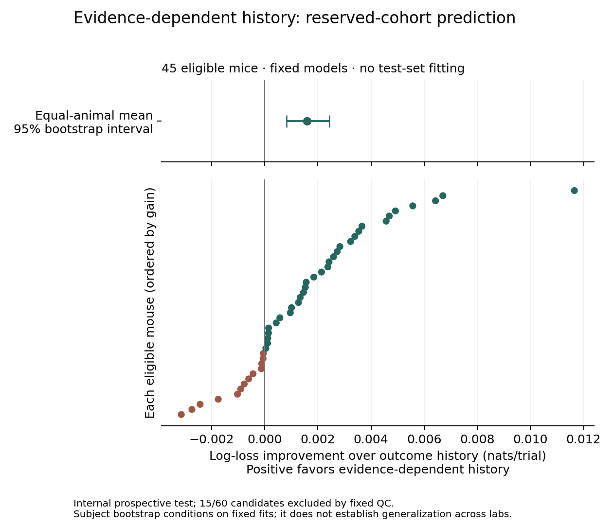

# AnimalTaskSim

**Test explanations of animal decisions against trial-level behavioral data.**

AnimalTaskSim provides task environments, comparison agents, schema-validated
trial logs, and a shared evaluation pipeline. Explanations are judged by
held-out prediction of animal choices and by behavioral fingerprints, not by
reward alone.

## What has been established

**1. A source-verified mouse reference.** The adopted IBL reference (120
sessions, 86,648 trials) was reconciled against the public ALF arrays. It covers
**83 mice across 9 labs**. Reconciliation found **255 misclassified omissions**
in 49 sessions, corrected in a separate candidate file. With that correction the
raw weak-minus-strong failure retry gap is **−0.0853**: the opposite sign to the
signature the earlier adaptive controller was built to produce.
[Source reconciliation](docs/SOURCE_RECONCILIATION.md).

**2. A small evidence-dependent history effect that replicated.** Models and
rules were frozen before a reserved cohort was downloaded. On the 45 of 60 mice
that met the fixed QC gates, adding evidence-dependent outcome history improved
prediction by **0.00160 nats/trial** (95% subject-bootstrap interval
**[0.00082, 0.00244]**; 32/45 mice improved). No test-data fitting, threshold
changes, or replacement subjects were used.
[Result and limitations](docs/REPLICATION_RESULT.md) ·
[Frozen protocol](docs/REPLICATION_PROTOCOL.md).



This is a small predictive effect under specified controls. It is not a neural
mechanism and not a novelty claim: difficulty-dependent history has close
precedents ([literature comparison](docs/NOVELTY_REVIEW.md)). The freeze was
internal, not an external preregistration, and 21 of the 45 mice come from one lab.

## What has not been established

**The effect is not yet separated from slow drift or state switching.** On 83
development mice, trial history still improves prediction after adding an
explicit drift model (**+0.0146 nats/trial**) or a three-state GLM-HMM
(**+0.0143**). But the recovery study did not pass its gate: across 360
simulations, strong history effects were recovered in 40/40 runs and weak ones
in 0/40, and the drift grid missed its numerical tolerance. Earlier small
simulations also showed drift alone can produce apparent history gains.
[Generative comparison](docs/GENERATIVE_COMPARISON.md) ·
[Protocol and mathematics](docs/GENERATIVE_COMPARISON_PROTOCOL.md) ·
[Bias controls](docs/BIAS_HISTORY.md) ·
[Competing history models](docs/COMPETING_HISTORY.md).

**The hybrid architecture is not validated.** The original research question
was whether separating longer-term memory from fast outcome-driven adaptation
improves prediction of animal choices and response times.

- After a September repair of feedback access, DDM conventions and training
  continuity, the full model **did not pass** its first prediction gate: it lost
  to a one-step history predictor (choice NLL 0.52579 vs 0.46450).
  [Repair](docs/ARCHITECTURE_REPAIR.md) · [Validation](docs/ARCHITECTURE_VALIDATION.md).
- With longer choice-only training it does beat simple history (0.44654 vs
  0.46450), on reused development animals and with worse timing error.
  [Fitting diagnosis](docs/FITTING_DIAGNOSIS.md).
- The adaptive controller adds nothing resolvable over the reduced recurrent
  model (0.44585 vs 0.44654, interval spanning both directions).
  [Matched comparison](docs/MATCHED_CHOICE_CONTROL.md).

A software lesion establishes a contribution within a model; it does not
establish a necessary mechanism in an animal.

## Where the project stands

**A fresh confirmation cohort is deferred.** Before another cohort is accessed,
the comparison needs reliable identification at the intended effect size, a
fitted continuous-drift benchmark, stable numerics, and a power study matched
to the exact endpoint. All completed cohort results are preserved, and a new
protocol must be frozen first. [Research plan](docs/RESEARCH_PLAN.md).

## Start here

```bash
pip install -e ".[dev]"
MPLBACKEND=Agg pytest
PYTHONPATH=. MPLBACKEND=Agg python scripts/render_ibl_replication_figure.py
```

The figure command reads the tracked result snapshot and needs no new download
or model training. The existing scored cohort is protected against overwrite.

| To understand | Read |
|---|---|
| The replicated result, scores and exclusions | [REPLICATION_RESULT](docs/REPLICATION_RESULT.md) |
| History versus drift and switching | [GENERATIVE_COMPARISON](docs/GENERATIVE_COMPARISON.md) |
| What happens next and why | [RESEARCH_PLAN](docs/RESEARCH_PLAN.md) |
| How the reference data were verified | [SOURCE_RECONCILIATION](docs/SOURCE_RECONCILIATION.md) |
| The first exploratory audit | [HISTORY_AUDIT](docs/HISTORY_AUDIT.md) |
| The full dated experiment record | [FINDINGS](FINDINGS.md) |
| Which script does what | [scripts/README](scripts/README.md) |

## What is active

| Area | Status |
|---|---|
| IBL reference and history analysis | Active: validate the phenomenon and compare simple explanations |
| Trial logging, schema, metrics, tests | Shared scientific infrastructure |
| Sticky-Q, Bayes, DDM, PPO, Hybrid, R-DDM | Retained comparison implementations; no new calibration sweeps planned |
| Hybrid, adaptive control and PRL | Repaired implementation; not validated against animals |
| DMS | Environment scaffold; expansion deferred until the IBL validation milestone |

Historical commands retain their names, flags, and output paths. Existing
`persistence_only` defaults remain for compatibility, **not as an endorsement
of an animal-validated mechanism**.

## Pipeline

```text
Agent → Environment → validated trials.ndjson → evaluator → metrics/report
Animal reference ───→ validated trials.ndjson → held-out model comparison
```

The environment owns agent trial logging. Offline analyses consume logs and
write separate analysis artifacts; they do not fabricate environment trials.

```bash
python scripts/train_agent.py --help
python scripts/evaluate_agent.py --run runs/your_run
python scripts/make_report.py --run runs/your_run
```

## Data and limits

The adopted IBL dataset has **120 sessions / 86,648 trials**. The macaque RDM
reference has 2,611 trials. PRL and DMS currently have no animal reference here.
IBL data attribution and CC-BY 4.0 terms are in [data/README.md](data/README.md);
repository code is MIT.

The environments are task abstractions. In particular, simulated IBL block
lengths and response timing differ from the published protocol. Existing
chronometric and lesion results need those qualifications. Old figures use an
older reference and are retained under `docs/figures/` as historical artifacts.

Raw run directories (`runs/`) are local and not tracked. Portable result
snapshots for every reported number are under `docs/results/`.
