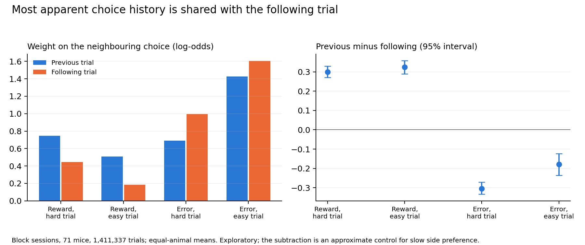

# First look at the deep development reference — November 23, 2026

**Status: exploratory.** These are previously inspected development animals,
with no quality filtering and no predeclared endpoint. Nothing here is a
confirmed result. Its purpose is to decide what to test next.

[Acquisition protocol](DEEP_REFERENCE_PROTOCOL.md) ·
[Portable results](results/deep_exploration_v1.json) ·
[Session list and hashes](results/deep_reference_v1_sessions.csv)

## Data

Every standard session of the development animals that the public server
returned: **3,946 sessions, 2,537,937 trials, 72 mice, 9 labs** (biased 2,115
sessions; training 1,635; ephys 196). Four cached sessions with missing or
mismatched arrays were skipped. Mice contribute 21 to 103 sessions each, against
about 1.4 in the adopted reference. Session families are analysed separately.

Choice coding was checked against feedback in every session before use.

## 1. Most apparent choice history is shared with the following trial

A ridge logistic regression per mouse predicts the current choice from signed
contrast, block, and the neighbouring trial's choice split by outcome (rewarded
or not) and difficulty (hard is |contrast| ≤ 0.125). It was fitted twice: once
with the **previous** trial as the neighbour and once with the **following**
trial. The following trial cannot cause the current choice, so its weight
measures whatever slow side preference the two trials share.

Equal-animal mean weights in block sessions (71 mice, 1,411,337 trials; log-odds):

| Neighbouring trial | Previous | Following | Previous − following (95% interval) |
|---|---:|---:|---:|
| Rewarded, hard | 0.744 | 0.444 | +0.300 [0.271, 0.329] |
| Rewarded, easy | 0.510 | 0.185 | +0.325 [0.289, 0.358] |
| Error, hard | 0.690 | 0.994 | −0.304 [−0.334, −0.271] |
| Error, easy | 1.425 | 1.605 | −0.179 [−0.237, −0.124] |



- The following trial predicts the current choice nearly as well as the previous
  one, and better after errors. Most of the raw weight is therefore not an
  effect of the previous trial.
- The difference keeps the expected signs: more repetition after rewards, more
  switching after errors.
- The raw difficulty effect after rewards (+0.235) is absent in the difference
  (−0.025 [−0.042, −0.006]). After errors a difficulty effect remains: switching
  is stronger after hard errors.
- The same signs appear without blocks: training sessions (59 mice) give
  +0.104, +0.081, −0.229, −0.077, and the first 90 unbiased trials of block
  sessions (52 mice) give +0.200, +0.230, −0.254, −0.174.
- An error on an easy trial carries the largest weight in both directions. It is
  the strongest marker in these data of a period of side preference.

The subtraction is an approximation. Real effects of the current trial on the
following one are counted as shared preference, so the difference can
under-estimate or distort true history effects. It is a diagnostic, not an
estimate of a causal weight. A synthetic check (`tests/test_explore_deep_reference.py`)
confirms that it cancels pure drift and keeps a planted reward-repeat effect.

## 2. Individual differences are stable

Fitting odd and even sessions separately (66 mice with enough data), the
split-half correlation across mice is **0.88** for the net reward-repeat weight,
**0.60** for the net error-switch weight, and **0.74** for overall stickiness.

## 3. Mice follow block changes within a few trials

On hard trials, the fraction of choices toward the newly favoured side is about
31% before a block change, 53% in the first five trials after it, and about 70%
from trial 15 onward. The median block is 45 trials.

## 4. Learning is late and steep

Aligned to each mouse's first block session, easy-trial accuracy rises from
about 55% to 95% over roughly a dozen sessions and is flat near 96% afterwards.
The median mouse has 19 training sessions before its first block session.

## 5. Late in a session, speed changes and accuracy does not

Easy-trial accuracy stays at 93–94% across the session. Median response time is
about 0.46 s for the first 600 trials, then rises (0.59 s at 700; 0.65 s at
800). The median session has 699 trials.

## Interpretation and limits

Taken together, the largest structure in these data is slow: side preference
lasting many trials, stable differences between animals, and within-session
changes in speed. The trial-to-trial outcome effect is real in sign but small by
comparison. This matches published accounts of mice alternating between engaged
and biased states in this task, and it motivates the
[current research plan](RESEARCH_PLAN.md). That reading is a hypothesis.

- No state model was fitted here. "State" is an interpretation of regression
  weights, not a measured quantity.
- Sessions were not filtered for quality, and training sessions include repeated
  trials after errors, which inflate history weights there.
- Intervals bootstrap over animals and ignore within-animal fitting uncertainty.
- All animals were inspected before. No reserved or untouched animal was used.

## Reproduction

```bash
python -m scripts.explore_deep_reference
PYTHONPATH=. MPLBACKEND=Agg python scripts/render_state_direction_figures.py
```

The first command needs the local raw arrays from the acquisition protocol. The
second reads only tracked snapshots.
