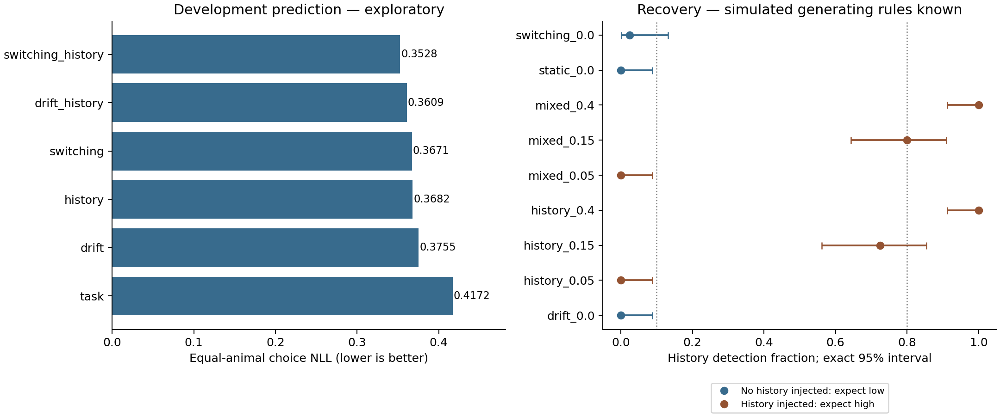

# Generative model comparison — September 19, 2026

**Decision: fresh confirmation remains deferred.**

This comparison tests whether history adds prediction beyond explicit latent preference models. It does not establish a learning mechanism, neural necessity, controller superiority or novelty.

[Protocol and simple mathematics](GENERATIVE_COMPARISON_PROTOCOL.md) · [Portable results](results/generative_comparison_v1.json)

## Development results

Common sample: 73,332 trials from 83 development animals; five animal-disjoint folds.

| Model | Equal-animal NLL |
|---|---:|
| switching_history | 0.352752 |
| drift_history | 0.360938 |
| switching | 0.367094 |
| history | 0.368151 |
| drift | 0.375514 |
| task | 0.417169 |

| Added history model | Mean NLL gain | Clustered 95% interval |
|---|---:|---|
| history vs its no-history counterpart | 0.049018 | 0.038589–0.065719 |
| drift_history vs its no-history counterpart | 0.014577 | 0.009169–0.022487 |
| switching_history vs its no-history counterpart | 0.014342 | 0.008622–0.022931 |

These contrasts add the full history feature set. They are **not** estimates of the earlier difficulty-only residual gain of 0.000421 nats/trial. Models, nuisance features and scoring protocols must be compared within the same experiment.

## Recovery and power

| Generator / history strength | Oracle conditional KL | Detected / runs | Exact 95% interval | Selected fits converged | Qualification |
|---|---:|---:|---|---|---|
| drift_0.0 | 0.000000 | 0/40 | 0.000–0.088 | True | True |
| history_0.05 | 0.000390 | 0/40 | 0.000–0.088 | True | False |
| history_0.15 | 0.003417 | 29/40 | 0.561–0.854 | True | False |
| history_0.4 | 0.022372 | 40/40 | 0.912–1.000 | True | True |
| mixed_0.05 | 0.000367 | 0/40 | 0.000–0.088 | True | False |
| mixed_0.15 | 0.003238 | 32/40 | 0.644–0.909 | True | False |
| mixed_0.4 | 0.021581 | 40/40 | 0.912–1.000 | True | True |
| static_0.0 | 0.000000 | 0/40 | 0.000–0.088 | True | True |
| switching_0.0 | 0.000000 | 1/40 | 0.001–0.132 | True | False |

Failed fits retained: 0 development fits; 0 recovery fits. A failed optimizer prevents mechanistic interpretation of that run; its score is preserved, not silently discarded.

Individual optimizer attempts that hit a limit or failed: 0 development starts and 1 recovery starts. The table's convergence flag refers to the selected lowest-training-objective fit; all starts are retained in the raw artifacts. This does not certify a global optimum.

The simulations reuse development task schedules and omission positions, with entirely new responses and lab/animal/session heterogeneity. Their conditional oracle effect size is reported in the portable results; it is not the detectable marginal gain. The observed winner frequencies are also retained. Forty repetitions per cell qualify only these specified scenarios, not universal power.

A qualification failure is not proof that history and preference changes are always indistinguishable. In particular, one false detection out of 40 switching-only runs does not demonstrate a high false-positive rate; its confidence interval is too wide to certify the predefined 10% upper bound. Power and numerical resolution impose separate limits.

## Verification and limitations

- Independent reconstruction checks task/history features, common scoring rows, every saved development prediction, losses, summaries and source hashes.
- The pinned author implementation checks GLM-HMM emission probabilities and causal filtering at the saved parameters. It does not independently refit models or reproduce the published paper.
- A supplementary matched refit uses the author package likelihood and autograd derivatives, with the same features, priors, initialization strategy and scipy optimizer. This checks an independent likelihood implementation, not a reproduction of the published cohort or analysis.
- The drift model is a fixed-parameter AR(1) grid approximation, not PsyTrack. A fitted continuous-drift benchmark remains required.
- The supplementary 21-versus-41-state comparison checks numerical resolution without changing the primary grid.
- These are previously inspected animals. Lab/animal bootstrap intervals are conditional on fitted models and omit uncertainty from refitting the training population.
- Recovery uses two complementary animal folds while development uses five. These simulation results do not directly calibrate five-fold performance or the sample size for a future frozen-model confirmation study.
- The simulator scales the entire history rule. It does not isolate a small difficulty interaction on top of strong ordinary history. Its power results must not be treated as a direct power calculation for the earlier difficulty-specific finding.
- Synthetic dataframes are choice-analysis inputs, not complete schema-valid task rollouts; unused original fields such as reaction time are not simulated or consumed by the models.
- Initial 250-iteration zero-initialized fits were interrupted after convergence failures; their plan, six completed recovery datasets, development scores and source snapshot remain in the original run directory. The second attempt uses training-GLM initialization and a 1000-iteration budget. This is a documented numerical revision, not a change to the scientific success thresholds.

## What is next

A new cohort requires reliable identification at the intended effect size, stable numerics, a fitted continuous-drift benchmark alongside the completed matched GLM-HMM refit, endpoint-specific power checks, and a new timestamped protocol with sample size and stopping rules. If recovery remains ambiguous, prioritize more informative within-animal recordings or a task manipulation with different predictions under drift and learning. Do not obtain fresh outcomes merely to repeat a favorable development score.

Reproduce with the commands in the protocol; all completed run artifacts are retained under `runs/generative_history_20260919_v2`. No new animal data were acquired.

## Numerical qualification results

Drift grid qualification passed: **False**.

Author-code matched refit qualification passed: **True**.

- drift: 41-minus-21-state NLL change 0.000519686; fixed tolerance 0.000100.
- drift_history: 41-minus-21-state NLL change -0.000204924; fixed tolerance 0.000100.
- switching: independently refitted author-code NLL difference -0.000000088.
- switching_history: independently refitted author-code NLL difference 0.000000095.
