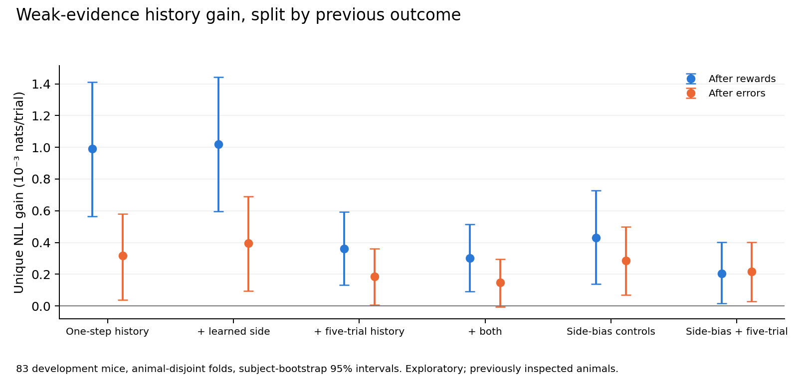

# Evidence-dependent history split by previous outcome — November 23, 2026

**Status: exploratory, on previously inspected development animals.**

[Portable results](results/outcome_split_v1.json) ·
[Per-animal scores](results/outcome_split_v1_subject_scores.csv)

## Question

The replicated evidence-history extension adds two terms: previous choice ×
weak previous stimulus, once after rewards and once after errors. The
[deep exploration](DEEP_EXPLORATION.md) suggested the reward term might be an
artefact of slow side preference while the error term is real. Which term
carries the gain once preference is controlled?

## Prediction, written before fitting

If the lead holds, the unique gain of the reward term shrinks to an interval
containing zero under the strongest control (`bias_long`), while the unique gain
of the error term stays positive. The prediction is stored in the run's
`plan.json` and in the portable results.

## Method

For each of the six fixed controls from the
[competing-history](COMPETING_HISTORY.md) and [bias](BIAS_HISTORY.md) studies,
four nested models are fitted: the control alone, plus the reward term, plus the
error term, plus both. Data, eligibility, folds, ridge penalty and fitting code
are those of the frozen studies. The **unique gain** of a term is the NLL
improvement from adding it to a model that already contains the other term.

A unit test confirms that adding both terms reproduces the frozen
`combined_evidence` and `bias_long_evidence` comparisons to within 1e-9.

## Result

83 development mice; unique gain in 10⁻³ nats/trial with subject-bootstrap 95%
intervals.

| Control | After rewards | After errors |
|---|---:|---:|
| One-step outcome history | 0.99 [0.57, 1.41] | 0.32 [0.04, 0.58] |
| + learned-side estimates | 1.02 [0.60, 1.44] | 0.40 [0.09, 0.69] |
| + five-trial history | 0.36 [0.13, 0.59] | 0.19 [0.01, 0.36] |
| + both | 0.30 [0.09, 0.51] | 0.15 [−0.01, 0.29] |
| Side-bias controls | 0.43 [0.14, 0.73] | 0.29 [0.07, 0.50] |
| Side-bias controls + five-trial history | 0.21 [0.02, 0.40] | 0.22 [0.03, 0.40] |



**The prediction failed as stated.** Under the strongest control the reward
term's interval excludes zero, narrowly.

What the data do show:

- The reward term loses about 80% of its gain as controls strengthen (0.99 to
  0.21). The error term loses about 30% (0.32 to 0.22).
- Under the strongest control the two terms are about equal and both small.
- Fitted weights keep their signs under every control: more repetition after a
  hard rewarded trial, more switching after a hard error.
- Without the optogenetic and RPE sessions (71 mice) the pattern is the same:
  0.24 [0.00, 0.48] after rewards and 0.25 [0.01, 0.48] after errors under the
  strongest control.

## Synthetic generators

The same analysis was run on four simulated populations (12 animals × 500
trials, five seeds each). Mean unique gains in 10⁻³ nats/trial:

| Generator | Control | Reward term | Error term |
|---|---|---:|---:|
| Slow drift, no history | One-step history | +0.47 | −0.05 |
| Slow drift, no history | Side-bias + five-trial | −0.12 | +0.03 |
| Real error-only term | One-step history | −0.03 | +0.75 |
| Real error-only term | Side-bias + five-trial | +0.02 | +0.78 |
| Static bias only | Side-bias + five-trial | −0.01 | −0.16 |

Slow drift alone produces an apparent reward term under weak control and no
error term; the strongest control removes it. A planted error-only term is
recovered as error-only. This supports reading most of the reward term's
original size as side preference.

## Limits

- Previously inspected animals; six controls and five contrasts each, without
  multiplicity correction. Intervals near zero should not be read as detections.
- The synthetic populations are small. The planted error term had an interval
  above zero in only 1 of 5 seeds (3 of 5 with drift added), so the simulations
  show the direction of the bias, not the power of the test.
- The controls are causal filters and lags, not fitted state models. A residual
  reward term may still reflect preference they do not capture.
- Gains this small have no demonstrated behavioural importance.

## Consequence

Neither term is dropped. The earlier one-step estimate of the evidence effect
overstated the reward half. The open question moves from "is there
evidence-dependent history" to "how much of apparent history is slow state",
which the [current plan](RESEARCH_PLAN.md) addresses with within-animal data.

## Reproduction

```bash
python -m scripts.split_evidence_by_outcome
python -m scripts.split_evidence_by_outcome --previous-plan runs/competing_history_novariant_20261123/plan.json \
  --output runs/outcome_split_novariant_20261123
```
